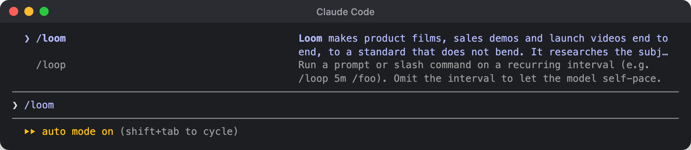
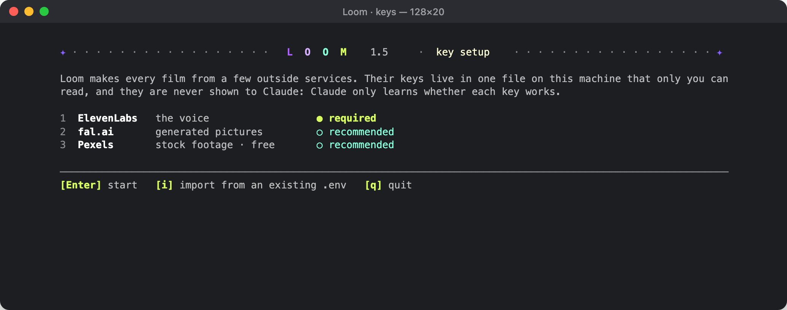
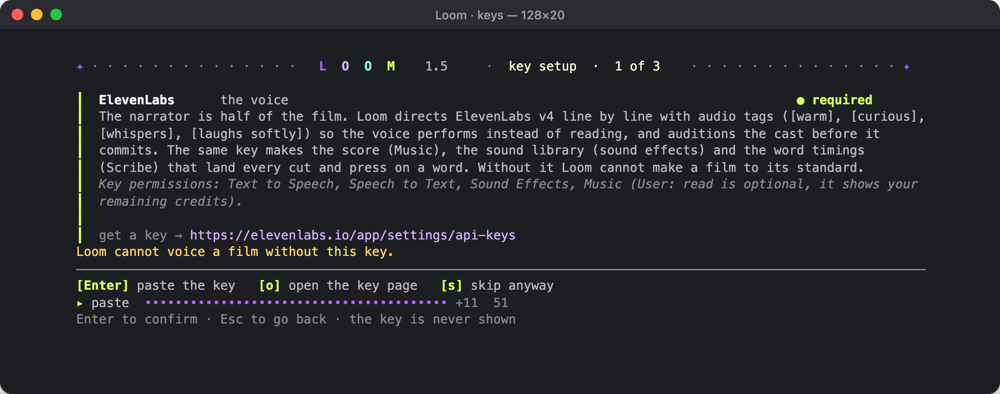
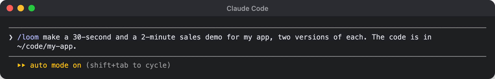

# Loom

**A film line for Claude Code.** You describe the film. Loom does the rest:

1. researches the product;
2. pitches concepts and lets you choose;
3. writes a screenplay per version;
4. voices it with ElevenLabs v4;
5. scores it;
6. builds it on HyperFrames;
7. checks every frame;
8. delivers a mastered MP4.

From zero to your first prompt takes about five minutes.

---

## 1. Install

You need [Claude Code](https://claude.com/claude-code), Node 18+ and ffmpeg.

```bash
brew install node ffmpeg          # macOS; on Linux use your package manager
git clone https://github.com/ReconchilleStudios/loom ~/.claude/skills/loom
```

That's all. HyperFrames, the picture engine, ships inside Loom (`vendor/hyperframes`). It is installed on the first run if your machine doesn't have it.

To update later: `git -C ~/.claude/skills/loom pull`

## 2. Open Claude Code, type `/loom`

Start Claude Code in any folder and type `/loom`.



## 3. Add your keys

On the first run Loom checks the machine, installs HyperFrames if needed, and asks to open the key window. Say yes. A separate terminal window opens:



Paste each key. It is masked, checked against its service and saved to `~/.claude/skills/loom/.env` (mode 600, never committed). Claude never sees a key, only whether it works.



| Service | What it does in your film | Need | Get a key |
|---|---|---|---|
| ElevenLabs | The narrator, the music, the sound effects, the word timings | **Required** | [elevenlabs.io/app/settings/api-keys](https://elevenlabs.io/app/settings/api-keys) |
| fal.ai | Generated people, scenes, image-to-video | Recommended | [fal.ai/dashboard/keys](https://fal.ai/dashboard/keys) |
| Pexels | Stock footage | Free, recommended | [pexels.com/api/new](https://www.pexels.com/api/new/) |

Close the window, go back to Claude Code and choose **Check keys**.

You can open the window yourself at any time:

```bash
bash ~/.claude/skills/loom/tools/keys/open.sh
```

## 4. Write the prompt



A good prompt says four things:

1. **What it's about,** and where Loom can learn it: a repo path, a URL, docs.
2. **Who watches:** customers in a sales call, investors, a social feed.
3. **How many and how long:** "two 30-second versions", "a 30 s and a 2 min".
4. **Anything fixed:** a script to use word for word, a line that must be said.

```text
/loom make a 30-second and a 2-minute sales demo for my app, two versions of each. The code is in ~/code/my-app.
/loom a 60-second launch video for https://example.com for investors. Use this script: "…"
/loom three 15-second vertical cuts for Instagram from the app in ~/code/my-app
```

## 5. What happens next

Loom asks before it spends anything:

1. **Brief.** It confirms who the film is for and what they must think when it ends.
2. **Research.** It reads your code and site and shows you what it found.
3. **Concepts.** You pick one per version from 5–6 cards.
4. **Versions.** You choose format, voices, what may be shown, where the films go and the budget, then **Start**.

After Start it works alone: one window per version, one render at a time. The finished MP4 and `.srt` files land in the folder you chose.

---

## Best for Loom 1.5

**Made for:** product films where software is the star.

- SaaS and app **sales demos**, 30 seconds to 2 minutes
- **Launch videos** and feature explainers built from real product screens
- **A/B versions** of one message: two stories with the same close, at two lengths
- **Vision demos** of screens not built yet, rebuilt from the product's own design system; you decide how they're labelled
- Motion-design films with a voiceover, where every click, counter and transition lands on a spoken word

**Not the best fit:**

- live-action stories with actors;
- long documentaries (6+ minutes);
- talking-head edits;
- music videos;
- brand films with no product on screen.

HyperFrames has workflows for some of these, but Loom's rulebook is tuned for product films.

**Under the hood**

| | |
|---|---|
| Picture | HyperFrames v0.8.140 (bundled): HTML + GSAP compositions rendered to H.264 MP4, 1920×1080 / 1080×1920 / 1080×1080, 30 fps |
| Voice | ElevenLabs `eleven_v4` / `eleven_v4_turbo`, directed with audio tags; auditions, two takes per line, every take transcribed back and compared with the script; each line levelled to −16 LUFS |
| Score | ElevenLabs Music from a plan that follows the film's acts; tempo and bars measured, the bed cut on the bar grid; the music never drops out under the voice |
| Sound | A generated effects library, cleaned automatically and mixed into one stem per film; the music carved under the voice |
| Media | fal (stills from reference photos, image-to-video), Pexels stock footage, Playwright stills of your product |
| Master | −14 LUFS integrated, ≤ −1 dBTP, AAC 48 kHz, plus a voice-only `.srt` |
| QC | HyperFrames lint and layout checks, a contact sheet of every scene, frames every 0.5 s, a speech-to-text check of the master, every claim checked against sources, three subagent viewers who haven't seen the plan |
| Parallel runs | One Claude Code window per version; a machine-wide lock keeps it to one render at a time |
| Cost | Every paid call is logged before it runs and refused beyond the budget you set |
| Platforms | macOS and Linux |

**The reference run** (`examples/affilimates/`): four sales demos (2 × 30 s, 2 × 2 min) made in parallel with the process Loom 1.5 is built from. Each took 42–74 minutes from prompt to master, and renders took 25 s to 2.5 min. Their bible and screenplays are the standard Loom holds every film to.

---

MIT licence (`LICENSE`). `vendor/hyperframes/` is HeyGen's [HyperFrames](https://github.com/heygen-com/hyperframes), unmodified, under Apache-2.0.
